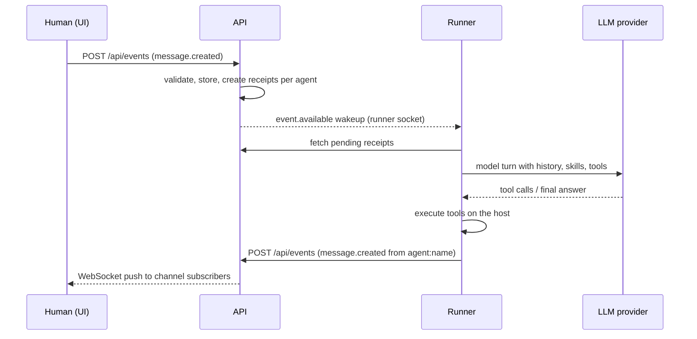

# Architecture

OrgOps is a TypeScript monorepo (npm workspaces) made of four runtime components and a
bootstrap CLI.

## Components

| Component | Path | Role |
| --- | --- | --- |
| **API** | `apps/api` | Hono HTTP + WebSocket server. The only process that writes to the SQLite database; runs migrations at startup. |
| **Agent runner** | `apps/agent-runner` | Host-local supervisor. Picks up events for its agents, runs model turns, executes tools and supervises processes. |
| **Admin UI** | `apps/admin-ui` | React + Tailwind operator console for agents, runners, channels, events, secrets, billing and more. |
| **User UI** | `apps/user-ui` | Lightweight workspace for non-technical users: channels, messages, active agents and recent activity. |
| **OpsCLI** | `apps/opscli` | Installs, upgrades and repairs OrgOps hosts; optional agentic chat mode. |

Shared packages:

| Package | Purpose |
| --- | --- |
| `packages/db` | SQLite schema (Drizzle ORM) and migrations |
| `packages/schemas` | Zod schemas and typed event shapes |
| `packages/event-bus` | In-process pub/sub |
| `packages/llm` | Provider/model wrapper around the Vercel AI SDK |
| `packages/crypto` | Envelope encryption helpers for secrets |
| `packages/skills` | Skill catalog discovery and parsing |
| `packages/js-runtime` | `node:vm` sessions used by `RLM_REPL` mode |
| `packages/events-scenario-tests` | JSON-driven end-to-end scenarios against a running stack |

## Event flow

Everything in OrgOps is an event appended to a log: a human message, an agent reply,
a tool execution, a process exit, a scheduled trigger.

Key properties:

- **At-least-once delivery.** Per-agent `event_receipts` track `PENDING` / `DELIVERED`.
  Socket wakeups are advisory; the runner also polls over HTTP to catch up after
  reconnects.
- **Idempotency.** Events can carry an `idempotencyKey`.
- **Scheduling.** `deliverAt` delays delivery; agents use this to wake themselves later.
- **Failure handling.** Failed handling increments a counter; after
  `ORGOPS_EVENT_MAX_FAILURES` (default 25) the event is dead-lettered.

## Host assignment

Multi-host execution is intentionally simple:

1. Each runner registers with the API and persists a stable ID in `.agent-runner-id`.
2. Each agent may be assigned to one runner (`assignedRunnerId`).
3. A runner only picks up agents assigned to its own ID.

This guarantees *same agent, same host* without a scheduler. Reassignment is an explicit
operator action (**Agents → Move** in the admin UI, or the `agents_move` tool).

## Production topology

In production builds both UIs talk to the API through same-origin `/api` and `/ws`
paths. Put the UIs and the API behind one public origin (or a reverse proxy) so session
cookies and WebSockets work. The [Docker image](../guides/deployment.md#single-image-container)
does this for you with an internal HAProxy.

## Federation

Separate OrgOps instances can share channels. A shared channel has one canonical
*home* instance; peers keep local *projection* channels that forward writes to the home
and sync its events. Agents can also be copied or moved between instances. See the
[Federation section of the spec](../SPEC.md#federation) for details.
