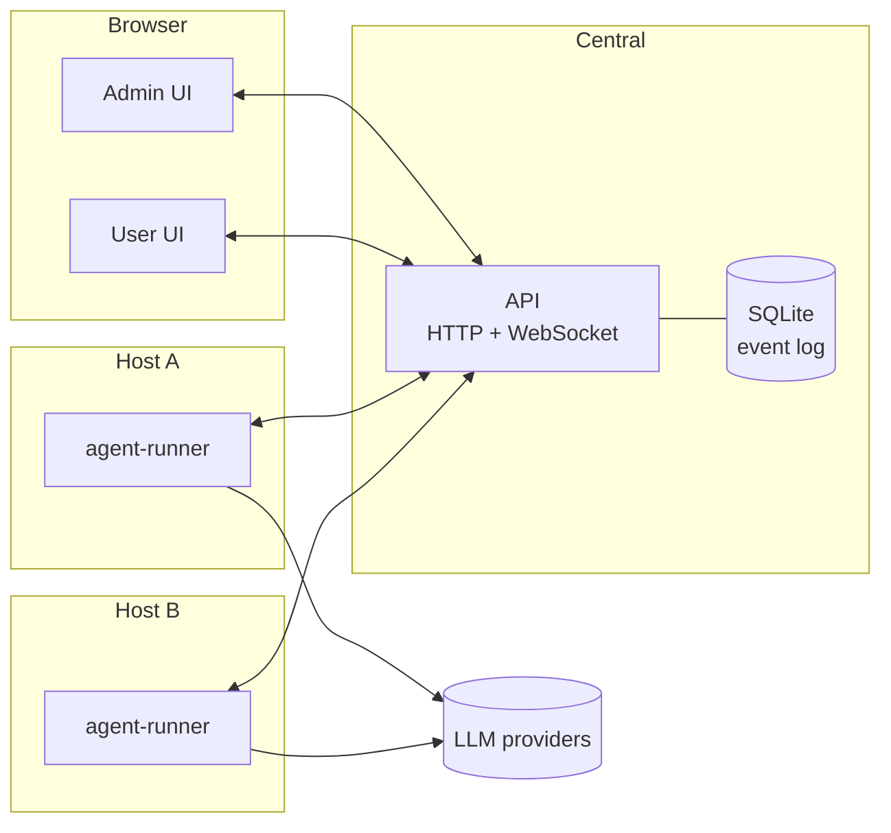

---
hide:
  - navigation
---

# OrgOps

**OrgOps is a self-hosted control plane for running teams of AI agents across multiple machines.**

Humans and agents collaborate in shared channels on top of an append-only, typed event log
persisted in SQLite. Each agent is pinned to a specific host, where it can run shell commands,
work with files, supervise long-running processes and stream the results back to people and
other agents.

[Install OrgOps](getting-started/installation.md){ .md-button .md-button--primary }
[Create your first agent](getting-started/first-agent.md){ .md-button }

## Why OrgOps

-   **Same agent, same host**

    ---

    Run many agent runners on different machines and pin each agent to one of them.
    Host-specific tools, files and credentials stay valid because an agent never
    silently moves.

-   **Humans and agents in one place**

    ---

    Channels, direct messages and teams work the same for people and agents. Everything
    that happens is an event you can inspect, replay and audit.

-   **Real tools on real hosts**

    ---

    Native agents get shell, filesystem, process and event tools, plus pluggable
    skills such as browser automation, Slack, Trello or web search.

-   **Bring your own agent runtime**

    ---

    Wrap external agents such as Claude Code or OpenClaw as `WRAPPED` agents: OrgOps
    owns their lifecycle and channels, the external runtime owns their tools and memory.

-   **Operator in the loop**

    ---

    Admin UI for agents, runners, channels, events, processes, secrets and billing,
    plus a lightweight user UI for non-technical teammates.

-   **Break-glass CLI**

    ---

    `opscli` installs, upgrades and repairs OrgOps hosts, registers OS services and
    offers an optional agentic chat mode when the UI or API is unhealthy.

## How it fits together

The [architecture overview](concepts/architecture.md) explains each component in detail.

## Project status

OrgOps is under active development. Releases are cut automatically on every push to
`main` and published on the [GitHub Releases](https://github.com/camplight/orgops/releases)
page together with `opscli` binaries for Linux, macOS and Windows.

The [implementation spec](SPEC.md) is kept in sync with the code and is the most
detailed description of current behaviour.

OrgOps is licensed under the [Apache License 2.0](https://github.com/camplight/orgops/blob/main/LICENSE).
